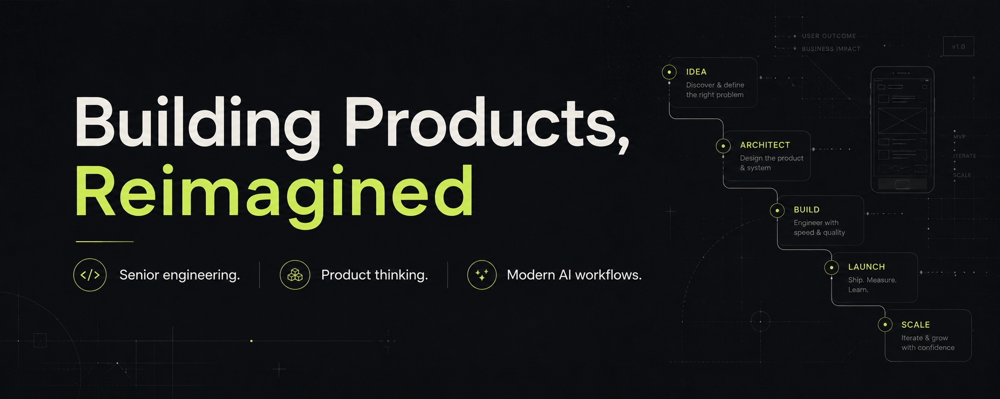

# 👋 Hi, I'm Mohamed Aimane

### Senior Software Engineer · Mobile & Web

I help founders, startups, and product teams turn ideas into scalable products — from architecture and implementation to launch and continuous improvement.

With **8+ years of experience**, I combine senior engineering, product thinking, and modern AI workflows to build and evolve products across iOS, Android, and Web.

**I don't just build apps. I help build products.**

### 🚀 What I Do

- 📱 **Mobile Products** — Cross-platform apps with React Native & Expo, plus native iOS and Android integrations
- 🌐 **Web Products** — Responsive web applications with React, Next.js, and React Native Web
- 🤖 **AI-Enabled Features** — Practical AI integrations, agents, and workflow automation
- 🏗️ **Architecture & Technical Leadership** — Sound technical decisions and systems designed to evolve
- ⚡ **MVPs & Product Delivery** — Turning ideas into production-ready products
- 🔧 **Modernization & Performance** — Improving reliability, maintainability, and user experience

### 🧭 How I Think About Engineering

- Products over features
- Systems over hacks
- Clarity over complexity
- Quality without sacrificing speed
- Continuous improvement over perfection

I care about more than getting features shipped. I care about making the right technical decisions, solving real user problems, and building foundations that support a product as it grows.

I use modern engineering practices, automation, and AI workflows to move efficiently while keeping engineering judgment and product quality at the center.

### ⚙️ Core Technologies

**Mobile**  
React Native · Expo · TypeScript · Native iOS & Android

**Web**  
React · Next.js · React Native Web

**Backend & Data**  
Node.js · Supabase · Firebase · PostgreSQL · GraphQL

**AI & Automation**  
OpenAI · Claude · Gemini · AI integrations · Agents · RAG · Workflow automation

**Engineering & Delivery**  
Clean Architecture · SOLID · TDD · CI/CD · GitHub Actions · Expo EAS

### 🌍 Experience & Impact

- 8+ years building and evolving software products
- ⭐ Upwork Top Rated Plus — Top 3%
- 📱 Experience shipping products to the App Store and Google Play
- 🌎 Experience across Healthcare, Education, Travel, Entertainment, Social, and SaaS
- 🤝 Collaborated directly with founders, startups, and product teams worldwide

### 📫 Let's Connect

Building a product and looking for an experienced engineering partner?

- 💼 [Work with me on Upwork](https://www.upwork.com/freelancers/medaimane)
- 🌐 [Explore my website](https://medaimane.github.io/)
- 🔗 [Connect on LinkedIn](https://www.linkedin.com/in/med-aimane-skhairi)

---

*Building Products, Reimagined.*
